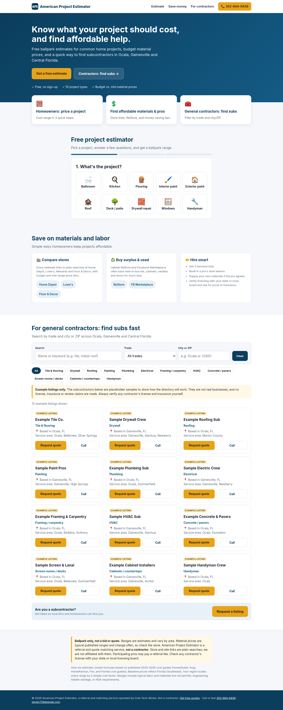
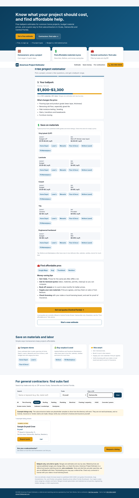

# American Project Estimator

A free, simple home-project cost estimator for homeowners and contractors. Pick a project type, enter the basic size and finish level, and get a ballpark cost range for materials and labor.

Built by Payton Cole, a construction estimator and project superintendent who has bid and managed 50+ residential homes in Florida and Oregon.

## Features
- Quick cost ranges for common residential projects
- Plain-language breakdown of materials vs. labor
- Mobile-friendly, single-page app (HTML, CSS, vanilla JavaScript; no build step)

## Run it
Open `index.html` in any browser, or serve the folder:

```bash
python3 -m http.server 8000
```

## Screenshots




## Roadmap
- Saved estimates and PDF export
- Subcontractor and material supplier lookup for general contractors

Estimates are ballpark ranges for planning only, not a bid or quote.
